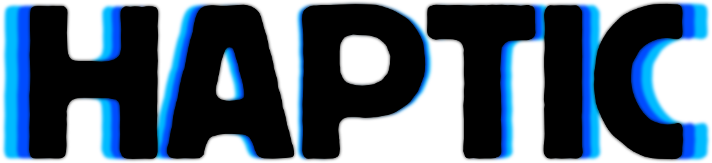

<h1 align="center">
  <picture>
    <source media="(prefers-color-scheme: dark)" srcset="engine-logos/HapticWordmark-DarkMode.png">
    
  </picture>
</h1>

<p align="center">
  The portable game engine.<br>
  Build 2D and 3D games on iPad, iPhone, Android, Mac, Windows and Linux.
</p>

<p align="center">
  <a href="https://hideoutgames.github.io/BabylonSlate/docs/">Documentation</a>
  &nbsp;·&nbsp;
  <a href="https://haptic.no">haptic.no</a>
  &nbsp;·&nbsp;
  <a href="https://hideoutgames.github.io/BabylonSlate/">Web preview</a>
</p>

---

**Touch first.** A full editor designed for iPad and iPhone, just as comfortable with a keyboard and mouse.

**Visual scripting.** Classes, events and functions built from nodes, plus graphs for materials, particles, animation and AI.

**2D and 3D.** Physically based or cel-shaded rendering, sprites and tilemaps, water, particles and post-processing, rendered with [Babylon.js](https://www.babylonjs.com).

**Physics, audio and AI.** Rigid bodies and ragdolls, spatial audio and mixing, behaviour trees and navigation.

**Your files.** A project is a plain folder you can keep in Files, sync with Git or share as a zip.

**Ship to the web.** Export a game as a single zip, ready for itch.io.

## Build from source

```bash
pnpm install
pnpm dev          # editor on localhost:5173
pnpm docs:dev     # documentation site
```

Contributors and agents start with [AGENTS.md](AGENTS.md).

<p align="center"><sub>© 2026 Bru Development ENK. Haptic™ is a trademark of Bru Development ENK.</sub></p>
